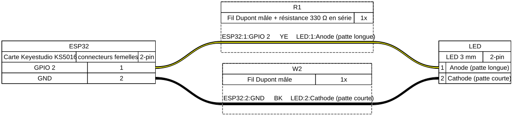

# Phase 0 — La carte programmée

À la fin de cette notice, la carte ESP32 tourne avec le firmware du régulateur, répond sur la liaison série, garde son mode après une coupure, et signale le défaut quand le capteur d'air manque. Aucun capteur, aucun relais, aucune tension secteur : seulement la carte, un câble USB et, si on l'a déjà, une LED.

Durée : 30 minutes environ.

## Ce qu'il faut

| Élément | Référence |
| --- | --- |
| Carte ESP32 | Keyestudio KS5016 (ESP32-WROOM-32, USB-C) |
| Câble | USB-C vers l'ordinateur, qui transporte les données (pas un câble de charge seule) |
| LED d'état | LED 3 mm, résistance 330 Ω (orange, orange, marron, or — ou orange, orange, noir, noir, marron sur une résistance à 5 anneaux), 2 fils Dupont mâles. Facultative en phase 0, nécessaire à partir de la phase 1 |
| Multimètre | Facultatif : remplace la LED pour vérifier l'étape 5 |
| Ordinateur | Avec le navigateur Chrome ou Edge, ou PlatformIO pour qui compile lui-même |
| Firmware | `ssk-terrarium-phase-0.bin`, sur la page de la version `phase-0` |

## Étape 1 — Câbler la LED d'état (facultative)

Sans LED sous la main, passer à l'étape 2 : la liaison série annonce le même défaut que la LED, et l'étape 5 dit comment s'en passer. La LED devient nécessaire à la phase 1.

Carte débranchée de l'USB :

1. Plier une patte de la résistance de 330 Ω (orange, orange, marron, or) et l'insérer avec un fil Dupont dans le connecteur **GPIO 2** de la carte — ou souder la résistance au bout du fil.
2. Relier l'autre patte de la résistance à la **patte longue** de la LED (l'anode).
3. Relier la **patte courte** de la LED (la cathode, côté méplat) à un connecteur **GND** de la carte.



La carte n'a pas de LED sur GPIO 2 : c'est celle-ci qui signalera un défaut.

## Étape 2 — Téléverser le firmware

**Depuis le navigateur**, sans rien installer :

1. Brancher la carte à l'ordinateur par le câble USB-C.
2. Ouvrir [l'outil de flash d'Espressif](https://espressif.github.io/esptool-js/) dans Chrome ou Edge.
3. Choisir 115 200 bauds, cliquer **Connect** et choisir le port de la carte (`USB Serial`, `CH340` ou `wchusbserial`).
4. Dans **Flash Address**, saisir `0x0` (et non la valeur proposée) et choisir le fichier `ssk-terrarium-phase-0.bin`.
5. Cliquer **Program** et attendre la fin, puis **Disconnect**.

**Depuis les sources**, pour qui a PlatformIO :

```bash
git checkout phase-0
pio run -e esp32dev -t upload
```

Si aucun port n'apparaît : essayer un autre câble USB-C ; sur un macOS ancien ou sous Windows, installer le pilote du convertisseur CH340 depuis le site de son fabricant, WCH.

## Étape 3 — Lire la liaison série

1. Ouvrir un moniteur série à **115 200 bauds** : la console de l'outil d'Espressif (bouton **Console**), ou `pio device monitor`.
2. Appuyer sur le bouton **RESET** (ou **EN**) de la carte.

La carte écrit, entre autres lignes de démarrage :

```
MODE MAINTENANCE
```

Au tout premier démarrage, elle n'a aucun mode enregistré : elle démarre en `MAINTENANCE`, où tout est coupé.

## Étape 4 — Changer de mode

Taper dans le moniteur, puis Entrée — la console du navigateur n'affiche pas ce qu'on tape, seule la réponse de la carte apparaît :

```
MODE HIBERNATION
```

La carte répond `MODE HIBERNATION`. Appuyer sur **RESET** : elle redémarre et écrit de nouveau `MODE HIBERNATION`. Le mode survit à une coupure, ce qui garde le hors-gel actif l'hiver après une panne de courant.

Une commande mal tapée (`mode actif` en minuscules par exemple) donne `ERREUR commande inconnue` et ne change rien. Remettre ensuite la carte en maintenance :

```
MODE MAINTENANCE
```

## Étape 5 — Observer le défaut capteur

Aucun capteur d'air n'est branché en phase 0 : le firmware doit le remarquer. Attendre 2 à 3 minutes après un démarrage, sans rien toucher :

- la liaison série écrit `DEFAUT capteur air` ;
- la LED d'état s'allume, si elle est câblée ;
- sans LED, un multimètre en voltmètre continu entre **GPIO 2** (pointe rouge) et **GND** (pointe noire) lit environ 0 V avant le défaut et environ 3,3 V après.

C'est la protection qui, à partir de la phase 1, coupera le chauffage et la pompe si le capteur se tait plus de 2 minutes.

## Fin de la phase 0

La phase est terminée quand les étapes 2 à 5 donnent ce qu'elles annoncent, et l'étape 1 si la LED est câblée. Laisser la LED d'état en place : elle sert à toutes les phases suivantes ; sans elle, la câbler avant de commencer la phase 1. La suite est la [notice de la phase 1](../phase-1/README.md).
