# Phase 1 — Le prototype d'hiver

À la fin de cette notice, le régulateur tient le bac à 19 °C en mode `ACTIF`, le protège du gel en mode `HIBERNATION`, et coupe le chauffage dès que le capteur d'air se tait. Les deux câbles chauffants passent par un relais. Cette phase se monte sans limiteur matériel ni fusible, reportés ([#9](https://github.com/sskorupski/ssk-terrarium/issues/9), [#10](https://github.com/sskorupski/ssk-terrarium/issues/10)) : si le relais 1 reste collé ou si le firmware se trompe, rien de matériel ne coupe le chauffage.

Durée : une demi-journée, en deux temps — le montage en très basse tension (étapes 1 à 8), puis le 230 V (étapes 9 et 10).

> **Le 230 V tue.** Les étapes 1 à 8 ne touchent qu'au 12 V, au 5 V et au 3,3 V. On ne passe à l'étape 9 qu'une fois toutes les précédentes validées, en particulier l'étape 4, qui vérifie que le module relais se commande comme le firmware l'attend. Qui n'a jamais câblé de 230 V fait faire l'étape 9 par quelqu'un qui en a l'habitude. Le circuit du garage doit être protégé par un différentiel 30 mA.

La notice part du montage de la [phase 0](../phase-0/README.md) terminé : la carte programmée, et sa LED d'état sur GPIO 2.

## Ce qu'il faut

Chaque pièce porte un repère, comme dans une notice de meuble. Chaque étape commence par la liste des pièces qu'elle utilise, et le texte comme les schémas citent le repère entre parenthèses : « l'adaptateur jack à vis (**G**) ». Les lettres I et O ne servent pas, pour ne pas les confondre avec 1 et 0 ; K est retirée avec la plaque d'essai qui n'est plus nécessaire, P et U avec le fusible et le limiteur, reportés après la phase 1. Les illustrations montrent le type de pièce, pas toujours le modèle exact ; leurs auteurs et licences sont en fin de notice.

| Repère | Pièce | Ce que c'est, et sa référence d'achat |
| --- | --- | --- |
| **A** | Carte ESP32<br>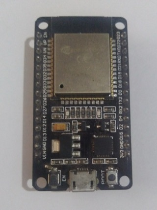 | La carte programmée à la phase 0, avec sa LED d'état et sa résistance de 330 Ω (orange, orange, marron, or) sur GPIO 2. Ses broches sont regroupées en blocs marqués sur la carte : le bloc **ANALOG**, colonnes `G` (picots noirs, GND), `V` (picots rouges, **3,3 V**) et `S` (picots jaunes, signal), pour les broches 35, 34, 33, 32, 4 et 2 ; le bloc **DIGITAL**, rangées `S`, `V` et `G`, pour les broches io14 à io26 et io18 à io12 — là, `V` donne **5 V**. Keyestudio KS5016. L'illustration montre une carte ESP32 générique ; la KS5016 a en plus une prise jack. |
| **B** | Capteur d'air<br>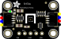 | Petite carte qui mesure la température et l'humidité de l'air, avec son câble STEMMA QT vers prises femelles, prolongé de fils Dupont mâle/femelle. Adafruit SHT45 n° 6174 |
| **C** | Sonde du substrat<br>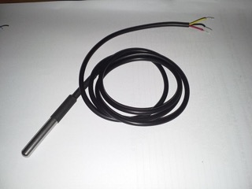 | Thermomètre étanche au bout d'un câble, à planter dans le substrat. DS18B20 DFRobot |
| **D** | Carte adaptatrice de la sonde<br>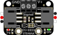 | Petite carte noire marquée « Plugable Terminal V2 », livrée avec la sonde (**C**) : trois bornes à levier blanches `A`, `B`, `C` où se pincent les fils de la sonde, une prise blanche à trois broches `−`, `+`, `D` vers la carte ESP32, et un cavalier `PULL UP` / `PULL DOWN`. DFRobot Terminal Sensor Adapter V2 (DFR0055). L'illustration montre l'adaptateur d'Adafruit, de même rôle. |
| **E** | Module relais<br>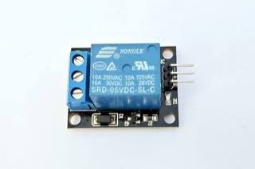 | Carte de quatre interrupteurs commandés, que la carte ESP32 (**A**) actionne pour allumer ou couper le chauffage ; un petit cavalier relie ses broches `VCC` et `JD-VCC`. Relais 5 V optocouplé Kiwi KW-1613. L'illustration montre un module à un seul relais ; le vôtre en a quatre côte à côte. |
| **F** | Bloc 12 V<br>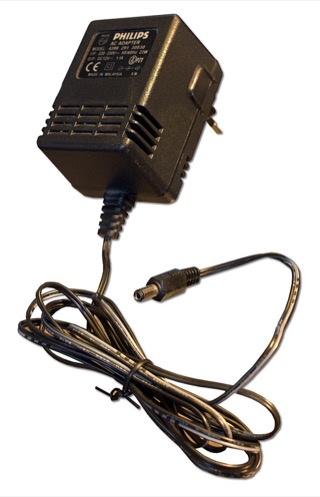 | L'adaptateur secteur : il se branche dans une prise murale et fournit du 12 V par un câble terminé par une fiche ronde, la fiche jack. HN Power HNP42EU-120, 12 V 3,5 A, fiche 5,5 × 2,1 |
| **G** | Adaptateur jack à vis<br>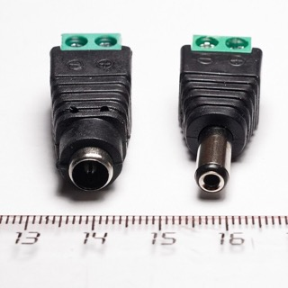 | Petite pièce sans électronique : un trou rond d'un côté, où s'enfonce la fiche jack du bloc 12 V (**F**), et deux vis de l'autre, marquées **+** et **−**, où se serrent des fils. Vendu sous le nom « embase jack femelle 5,5 × 2,1 à bornier ». Sur l'illustration, l'adaptateur femelle est celui de gauche. |
| **H** | Abaisseur 5 V<br>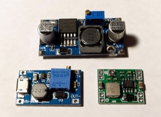 | Carte qui transforme le 12 V en 5 V pour les relais, avec un afficheur, un petit potentiomètre bleu, et quatre vis marquées **VIN+**, **VIN−** (entrée, le 12 V) et **VOUT+**, **VOUT−** (sortie, le 5 V) — `IN` et `OUT` sur certains modèles. LM2596 réglable à afficheur. L'illustration montre un modèle sans afficheur, en haut de la photo. |
| **J** | Cordon jack<br>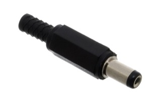 | Câble avec une fiche jack mâle 5,5 × 2,1 d'un côté et deux fils de l'autre : il alimente la carte ESP32 (**A**) depuis l'adaptateur jack à vis (**G**). L'illustration montre la fiche seule ; le cordon la porte déjà câblée. |
| **L** | Fils Dupont<br>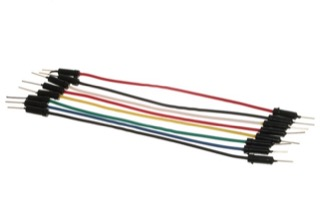 | Fils à embouts mâle/mâle et mâle/femelle : l'embout femelle s'enfiche sur un picot, la broche mâle dans un trou de la plaque d'essai ou sous une vis |
| **M** | Fil souple | Fil rouge et fil noir, pour relier les vis du 12 V entre elles |
| **N** | Cordon secteur<br>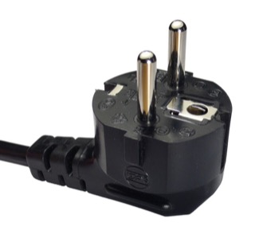 | Câble 3G 1 mm² terminé par une fiche de prise murale |
| **Q** | Socle de prise<br>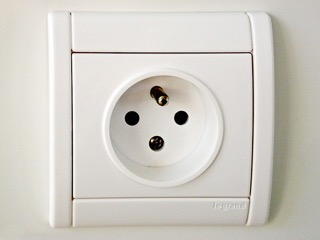 | Prise femelle à visser dans le boîtier, où se branchera la multiprise (**V**) |
| **R** | Fil marron 1 mm²<br>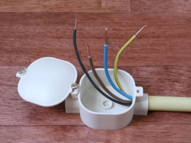 | Pour la phase du 230 V. Sur l'illustration, le fil marron est parmi d'autres couleurs. |
| **S** | Borniers à levier<br>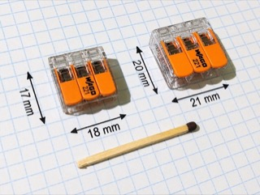 | Raccords où l'on serre des fils en abaissant un levier, sans outil |
| **T** | Boîtier électrique<br>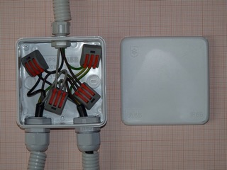 | Boîtier fermé, avec un presse-étoupe pour faire passer le cordon secteur (**N**) |
| **V** | Multiprise<br>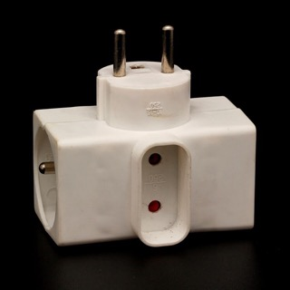 | Deux prises, pour les deux câbles chauffants |
| **W** | Câbles chauffants | Reptil'us 50 W et 25 W, déjà collés sur les vitres |

Outils et accessoires, sans repère :

- un multimètre, pointe noire dans la prise `COM`, pointe rouge dans la prise `VΩ`. En **voltmètre continu**, sélecteur sur `V⎓` (ou `V` avec un trait plein, parfois partagé avec l'alternatif : un bouton `FUNC` bascule de l'un à l'autre). En **testeur de continuité**, sélecteur sur la position qui porte le symbole `·)))`, souvent partagée avec `Ω`. Mettre les deux pointes en contact : la plupart des multimètres sonnent déjà dans ce réglage, sinon le bouton `FUNC` fait apparaître `·)))` à l'écran. Un multimètre qui ne sonne pas sert tout autant, en ohmmètre : deux bornes **reliées** affichent presque **0 Ω** (moins de 1 Ω), deux bornes **séparées** affichent **`OL`**. Dans cette notice, « sonne » veut dire l'un ou l'autre ;
- pour l'essai, une lampe de chevet et un sachet de glaçons ;
- le firmware : le fichier `.bin` de la version `phase-1`, sur sa page [Releases](https://github.com/sskorupski/ssk-terrarium/releases).

## Étape 1 — Téléverser le firmware de la phase 1

*Pièces : A.*

Carte seule, sans autre fil que la LED d'état :

1. Téléverser le fichier `.bin` de la version `phase-1` à l'adresse `0x0`, comme à l'étape 2 de la [phase 0](../phase-0/README.md).
2. Ouvrir le terminal série comme à l'étape 3 de la phase 0, puis appuyer sur le bouton **RESET** de la carte ESP32, à côté de sa prise USB.

Après les lignes de démarrage de la puce, la carte ESP32 (**A**) écrit :

```
=== ssk-terrarium phase-1 : demarrage ===
ABSENT capteur air
ABSENTE sonde substrat (optionnelle)
INFO aucun mode enregistre, demarrage en MAINTENANCE
MODE MAINTENANCE au demarrage
=== pret : regulation en cours ===
MESURE air=-- hr=-- substrat=-- chauffage=0 mode=MAINTENANCE
```

Les capteurs ne sont pas encore branchés : les deux lignes `ABSENT` sont attendues. Le téléversement efface le mode enregistré en phase 0 : la carte ESP32 repart en `MAINTENANCE`. Une ligne `MESURE` arrive toutes les 30 secondes, et `DEFAUT capteur air` au bout de 2 minutes environ, LED d'état allumée, puisque le capteur manque.

Débrancher l'USB.

## Étape 2 — Vérifier la polarité du bloc 12 V

*Pièces : F, G.*

Le bloc 12 V (**F**) alimentera l'abaisseur 5 V (**H**), puis la carte ESP32 (**A**). L'un comme l'autre peut griller si son **+** et son **−** sont inversés : on vérifie donc au multimètre, avant de leur brancher quoi que ce soit, que le bloc sort bien son **+** là où on l'attend.

La fiche jack du bloc ne se mesure pas directement : on l'enfonce dans l'**adaptateur jack à vis** (**G**), la petite pièce sans électronique qui la rend sur deux vis marquées **+** et **−**. Ne pas la confondre avec l'abaisseur 5 V, la carte à afficheur dont les vis sont marquées `VIN` et `VOUT` : il ne sert qu'à l'étape 3.

1. Bloc 12 V **débranché de la prise murale**, enfoncer sa fiche jack dans le trou rond de l'adaptateur jack à vis.
2. Régler le multimètre en tension continue (V⎓), calibre 20 V.
3. Brancher le bloc 12 V sur la prise murale.
4. Pointe **rouge** du multimètre sur la vis **+** de l'adaptateur, pointe **noire** sur la vis **−**.
5. Le multimètre lit entre **+12,0 et +12,6 V**. Une valeur **négative** veut dire une polarité inversée : s'arrêter là, et ne rien brancher sur ce bloc.
6. Débrancher le bloc 12 V de la prise murale.

## Étape 3 — Régler l'abaisseur 5 V

*Pièces : F, G, H, M.*

L'abaisseur 5 V (**H**) alimente les bobines des relais. Il sort d'usine réglé au hasard, parfois bien au-delà de 5 V : il se règle **à vide**, avant de lui brancher le module relais (**E**).

1. Bloc 12 V (**F**) débranché de la prise murale, relier par deux fils souples (**M**) la vis **+** de l'adaptateur jack (**G**) à l'entrée **VIN+** de l'abaisseur (fil rouge), et la vis **−** à **VIN−** (fil noir). Rien ne se branche sur sa sortie `VOUT`.
2. Brancher le bloc 12 V sur la prise murale. L'afficheur de l'abaisseur s'allume ; son bouton bascule entre la tension d'entrée et celle de sortie.
3. Multimètre sur la sortie : pointe rouge sur **VOUT+**, pointe noire sur **VOUT−**.
4. Tourner lentement la vis du petit potentiomètre bleu, qui demande de nombreux tours, jusqu'à lire **5,0 V** (entre 4,9 et 5,1 V) au multimètre. L'afficheur peut différer de quelques dixièmes : le multimètre fait foi.
5. Débrancher le bloc 12 V de la prise murale.

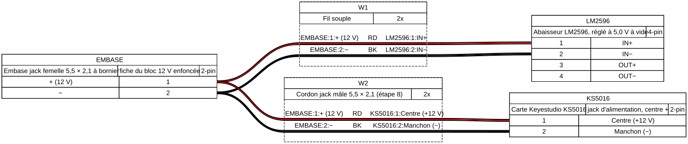

Le schéma montre aussi le cordon jack (**J**) vers la carte ESP32 (**A**) : il ne se branche qu'à l'étape 8.

## Étape 4 — Vérifier comment le module relais se commande

*Pièces : A, E, F, G, H, L.*

**Ce qu'on vérifie, et pourquoi.** Le module relais (**E**) porte quatre interrupteurs, les relais. Chacun se commande par une broche du module, `IN1` à `IN4`, que la carte ESP32 (**A**) reliera plus tard à l'une de ses propres broches. Selon les modèles, un relais s'enclenche quand sa broche `IN` est reliée au **GND** (0 V), ou au contraire quand elle reçoit du **3,3 V**. Le firmware est écrit pour la première sorte : pour garder le chauffage coupé, il envoie 3,3 V en permanence. Avec un module de la seconde sorte, ces mêmes 3,3 V allumeraient le chauffage en continu. On vérifie donc ici, avec un simple fil, de quelle sorte est le module, avant que la carte ESP32 ne commande quoi que ce soit.

Un relais **s'enclenche** : on entend un clic, et son petit voyant s'allume. Il **se relâche** : nouveau clic, et le voyant s'éteint.

Le module a deux rangées de broches : `GND IN1 IN2 IN3 IN4 VCC`, qui reçoit les ordres de la carte ESP32, et `VCC JD-VCC GND` à côté, avec un petit cavalier — un capuchon qui relie deux broches — entre `VCC` et `JD-VCC`. Ce cavalier se retire pour alimenter séparément les deux parties du module : la partie qui reçoit les ordres en 3,3 V par la carte ESP32, et les électroaimants qui actionnent les relais, plus gourmands, en 5 V par l'abaisseur (**H**).

1. Bloc 12 V débranché de la prise murale et câble USB débranché de la carte ESP32, **retirer le cavalier** de `JD-VCC` et le garder dans un sachet.
2. Relier la sortie de l'abaisseur au module par deux fils Dupont (**L**) mâle/femelle, un rouge et un noir. Les bornes `VOUT` de l'abaisseur sont des vis, les broches du module des picots : l'embout **femelle** s'enfiche sur le picot, la **broche mâle** se serre sous la vis, enfoncée à fond. Fil rouge de **VOUT+** vers **JD-VCC**, fil noir de **VOUT−** vers le **GND** de la même rangée. Tirer doucement sur chaque fil : il ne doit pas sortir de sous la vis.
3. Sur la carte ESP32 (**A**), repérer le bloc marqué **ANALOG** : trois colonnes de six picots, marquées `G`, `V` et `S` en tête, en face des numéros 35, 34, 33, 32, 4 et 2. La colonne `V` (picots rouges) donne le **3,3 V** : c'est la **rangée 3,3 V** de cette notice. La colonne `G` (picots noirs) est le GND : c'est la **rangée GND**. Tous les picots `G` et `GND` de la carte sont reliés entre eux : pour un GND, n'importe lequel convient, par exemple la colonne `GND` du bloc BUS I2C. Seul le 3,3 V impose le bloc ANALOG. Pour en être sûr : carte branchée par l'USB, multimètre en voltmètre continu, pointe rouge sur un picot `V` du bloc ANALOG, pointe noire sur un picot `G` : le multimètre lit entre **3,2 et 3,4 V**. Débrancher l'USB. **Les picots `V` du bloc DIGITAL et du bloc I2C donnent 5 V et non 3,3 V** : ne pas s'en servir dans cette notice.
4. Avec deux fils Dupont (**L**), relier une broche de la **rangée 3,3 V** au **VCC** de la rangée `GND IN1 … VCC` du module, et une broche de la **rangée GND** à son **GND**. Ne rien brancher sur `IN1` à `IN4`.
5. Brancher la carte ESP32 par l'USB, puis le bloc 12 V (**F**) sur la prise murale. Aucun relais ne s'enclenche : une broche `IN` reliée à rien laisse son relais relâché.
6. Avec un fil Dupont (**L**), relier **IN1** à une broche libre de la **rangée GND** de la carte ESP32 : le relais 1 s'enclenche. Retirer le fil : il se relâche.
7. Relier **IN1** à une broche libre de la **rangée 3,3 V** : rien ne se passe.
8. Recommencer les gestes 6 et 7 pour `IN2`, `IN3` et `IN4`.
9. **Repérer les bornes du relais 1.** Chaque relais a, sur le bord du module, trois vis côte à côte, avec à côté le dessin imprimé d'un interrupteur et le nom du relais (`K1` pour le relais 1). Ces vis ne portent souvent aucune inscription :
   - celle **du milieu** est **COM** (le commun) ;
   - des deux autres, l'une est **NC**, reliée à COM quand le relais est relâché, l'autre **NO**, reliée à COM seulement quand il est enclenché.

   Pour les distinguer : multimètre en testeur de continuité, relais 1 relâché, une pointe sur la vis du milieu, l'autre sur chaque vis extérieure tour à tour. Celle qui sonne est **NC** ; l'autre est **NO**. Puis relier `IN1` à la rangée GND : le relais s'enclenche, et c'est maintenant COM–NO qui sonne, COM–NC plus. Marquer la vis **NO** au feutre : c'est elle qui servira au 230 V, à l'étape 9.
10. Débrancher le bloc 12 V, puis l'USB.

**Le résultat attendu** : chaque relais s'enclenche avec sa broche `IN` au GND, et reste relâché avec elle au 3,3 V ou reliée à rien. Le module est alors de la bonne sorte, dite « à déclenchement bas » : noter ce résultat, il se reporte dans le cadrage du projet. **Si un relais s'enclenche avec sa broche `IN` au 3,3 V ou reliée à rien, s'arrêter là** et ne pas brancher le module à la carte ESP32 : le firmware ne convient pas à ce module.

## Étape 5 — Brancher les commandes des relais

*Pièces : A, E, F, L.*

Bloc 12 V débranché de la prise murale et câble USB débranché de la carte ESP32 (**A**). Les fils posés à l'étape 4 restent en place — abaisseur vers `JD-VCC` et `GND`, rangées 3,3 V et GND de la carte vers `VCC` et `GND` du module — ; seul le fil d'essai branché sur `IN1` se retire. Relier ensuite, par quatre fils Dupont (**L**), chaque entrée `IN` du module relais (**E**) à une broche **de signal** de la carte ESP32, celle qui porte le numéro du tableau :

| Entrée du module relais | Bloc de la carte ESP32 | Picot | Sortie |
| --- | --- | --- | --- |
| IN1 | DIGITAL | jaune `S` de la colonne `io26` | Chauffage |
| IN2 | DIGITAL | jaune `S` de la colonne `io27` | Ruban LED (phase 2) |
| IN3 | DIGITAL | jaune `S` de la colonne `io25` | Pompe de brumisation (phase 4) |
| IN4 | ANALOG | jaune `S` de la ligne `33`, colonne la plus à droite | Ventilateur (phase 2) |

Chaque fil ne relie qu'une broche à une broche : ni 3,3 V, ni GND, ni 5 V ici, le module est déjà alimenté depuis l'étape 4. Sur la carte ESP32, la broche de signal est le picot **jaune**, marqué `S` :

- **IO26, IO27 et IO25** sont dans le bloc **DIGITAL** : chaque numéro (`io26`, `io27`, `io25`) a une colonne de trois picots, jaune `S` en haut, rouge `V` (5 V) au milieu, noir `G` en bas. Le fil va sur le picot **jaune** de la colonne du numéro ;
- **IO33** est dans le bloc **ANALOG** : sur la ligne marquée `33`, le fil va sur le picot **jaune**, colonne `S`.

Les picots rouges et noirs **ne se branchent jamais sur une entrée `IN`**.

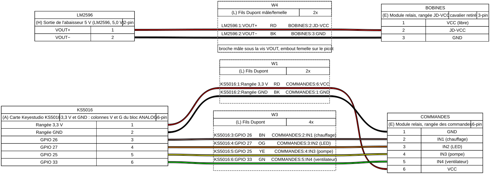

Puis vérifier qu'aucun relais ne s'enclenche tant que le firmware n'a rien décidé :

1. Brancher la carte ESP32 par l'USB, puis le bloc 12 V (**F**). Ouvrir le terminal série.
2. **Maintenir enfoncé le bouton RESET de la carte ESP32**, à côté de sa prise USB, au moins 5 secondes — le module relais n'a pas de bouton : la carte ESP32 est arrêtée, et ses broches ne commandent rien. Aucun relais ne s'enclenche.
3. Relâcher **RESET** : la carte ESP32 démarre. Aucun relais ne s'enclenche, ni pendant le démarrage, ni après `=== pret : regulation en cours ===`.
4. Taper `MODE ACTIF` puis **Entrée** : la carte ESP32 répond `MODE ACTIF enregistre, conserve apres coupure`. Le capteur d'air (**B**) n'étant pas branché, le chauffage reste coupé : le relais 1 ne s'enclenche pas.
5. Débrancher le bloc 12 V, puis l'USB.

Un relais qui s'enclenche, même un instant, carte en reset ou au démarrage : s'arrêter avant le 230 V.

## Étape 6 — Brancher les capteurs

*Pièces : A, B, C, D, L.*

Bloc 12 V débranché de la prise murale et câble USB débranché, les fils des étapes 4 et 5 restant en place. Sur la carte ESP32 (**A**), la rangée 3,3 V et la rangée GND sont celles de l'étape 4 : colonnes `V` et `G` du bloc ANALOG. Les signaux se prennent ainsi : `SDA` (IO21) et `SCL` (IO22) sur le bloc marqué **BUS I2C**, colonnes `SDA` (picots jaunes) et `SCL` (picots blancs) — jamais sa colonne `V`, qui donne 5 V ; IO4 sur la ligne `4` du bloc ANALOG, picot jaune `S` :

1. **Capteur d'air SHT45** (**B**), **sans soudure** : son câble STEMMA QT s'enfiche dans l'une des deux prises blanches du capteur, l'une ou l'autre. La barrette de picots livrée avec le capteur et les trous marqués `VIN 3Vo GND SCL SDA` ne servent pas. Le câble se prolonge au besoin de fils Dupont (**L**) : fil **noir** (GND) sur une broche de la rangée GND, **rouge** (V+) sur une broche de la rangée 3,3 V, **bleu** (SDA) sur un picot **jaune** du bloc BUS I2C, **jaune** (SCL) sur un picot **blanc** du même bloc. Le bloc BUS I2C est le carré de douze picots juste au-dessus du bloc ANALOG, à gauche de la puce ESP32 : quatre colonnes de trois picots, de gauche à droite noirs (`GND`), rouges (`V`, 5 V), jaunes (`SDA`) et blancs (`SCL`), avec `GND V SDA SCL` imprimé au-dessus et `BUS I2C` écrit verticalement sur le côté. Dans une même colonne, les trois picots se valent. À défaut, les deux premières prises femelles du connecteur du haut de la carte, marquées `SCL` et `SDA`, portent les mêmes signaux.
2. **Sonde DS18B20** (**C**) dans sa carte adaptatrice (**D**). Le tableau imprimé sur la carte, `D → A`, `+ → B`, `− → C`, dit où va chaque fil : le fil de **données** (jaune ou blanc) dans la borne **A**, le fil **rouge** (+) dans la borne **B**, le fil **noir** (−) dans la borne **C**. Pour chaque fil : abaisser le levier blanc, enfoncer le fil dénudé, relâcher le levier, tirer doucement : le fil tient.
   Placer le **cavalier** sur la position **PULL UP** : il branche la résistance de tirage que la sonde exige entre ses données et le +. Elle vaut 10 kΩ sur cette carte, au lieu des 4,7 kΩ prévus : avec le câble de la sonde, d'un mètre environ, cela suffit. Si la carte ESP32 écrit `ABSENTE sonde substrat` au démarrage alors que tout est branché, ajouter une résistance de 4,7 kΩ (jaune, violet, rouge, or — ou jaune, violet, noir, marron, marron sur une résistance à 5 anneaux) entre la borne A et la borne B.
3. **Carte adaptatrice vers la carte ESP32**, par le câble livré avec la sonde : sa petite fiche blanche dans la prise `− + D` de la carte adaptatrice, et ses trois fils vers la carte ESP32 — **−** (noir) sur un picot `G`, **+** (rouge) sur un picot `V` du **bloc ANALOG** (3,3 V), **D** sur le picot jaune `S` de la ligne **4** du bloc ANALOG. Si les trois fils sortent d'un même boîtier noir dans l'ordre noir, rouge, couleur, il s'enfiche d'un coup sur la ligne **4** du bloc ANALOG, noir côté `G`.

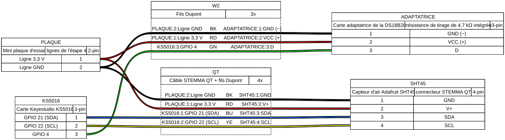

4. Brancher la carte ESP32 (**A**) par l'USB, puis le bloc 12 V (**F**). Ouvrir le terminal série et appuyer sur le bouton **RESET** de la carte ESP32.

Aucune ligne `ABSENT` au démarrage. Toutes les 30 secondes arrive une mesure, par exemple :

```
MESURE air=17.8C hr=62% substrat=17.5C chauffage=1 mode=ACTIF
```

La **première** ligne `MESURE` peut afficher `substrat=--` : la sonde met près d'une seconde à faire sa première mesure, et le firmware ne l'attend pas. Dès la deuxième ligne, une température s'affiche.

Les valeurs ressemblent à la pièce : une température proche de celle d'un thermomètre posé à côté, une humidité entre 30 et 80 %.

## Étape 7 — Vérifier la régulation et le défaut capteur

*Pièces : A, B.*

En mode `ACTIF`, le chauffage s'allume sous 18,5 °C et s'éteint à 19,5 °C. Les mesures arrivent toutes les 30 secondes : chaque effet attendu peut prendre ce délai.

1. **Chauffe** : si l'air est au-dessus de 18,5 °C, approcher du capteur un sachet de glaçons, sans le mouiller. Dès qu'une mesure passe sous 18,5 °C, le relais 1 s'enclenche et la mesure affiche `chauffage=1`.
2. **Arrêt** : retirer le sachet et réchauffer le capteur dans la main. Dès qu'une mesure dépasse 19,5 °C, le relais 1 se relâche et la mesure affiche `chauffage=0`.
3. **Défaut capteur** : relais 1 enclenché (refaire le geste 1 au besoin), débrancher le fil **bleu** (SDA) du capteur d'air (**B**). Au plus 2 minutes et demie plus tard, la carte ESP32 (**A**) écrit `DEFAUT capteur air`, le relais 1 retombe, et la LED d'état s'allume.
4. **Reprise** : rebrancher le fil bleu. À la mesure suivante, la carte ESP32 écrit `REPRISE capteur air`, la LED d'état s'éteint, et la régulation reprend.
5. **Hors-gel** : taper `MODE HIBERNATION` puis **Entrée**. Le chauffage ne s'allume plus que sous 4 °C : le relais 1 reste ouvert, même avec le sachet de glaçons. Taper ensuite `MODE ACTIF` puis **Entrée**.

## Étape 8 — Alimenter la carte ESP32 par le bloc 12 V

*Pièces : A, F, G, J.*

La carte ESP32 (**A**) quitte l'USB pour le bloc 12 V (**F**), qui l'alimente par le cordon jack (**J**).

1. Bloc 12 V et USB débranchés. Jusqu'ici, l'adaptateur jack à vis (**G**) n'alimente que l'abaisseur (**H**), par deux fils souples serrés sous ses vis depuis l'étape 3. Le **cordon jack** (**J**) est un **nouveau** câble, qui ira jusqu'à la prise jack jaune de la carte ESP32, marquée `DC 7-12V`. Desserrer chaque vis de l'adaptateur, glisser à côté du fil déjà en place celui du cordon jack, puis resserrer : son fil **+** (rouge) sous la vis **+**, l'autre sous la vis **−**. Chaque vis tient alors deux fils. Tirer doucement sur chacun. Si le cordon jack se termine par un adaptateur jack mâle à vis plutôt que par deux fils, le relier à l'adaptateur jack à vis par deux fils souples (**M**), rouge de **+** à **+**, noir de **−** à **−**.
2. Bloc 12 V branché, vérifier au multimètre que le **centre** de la fiche du cordon est à **+12 V** par rapport à son manchon extérieur, puis débrancher le bloc 12 V.
3. Enfoncer la fiche du cordon dans le **jack** de la carte ESP32.
4. Brancher le bloc 12 V sur la prise murale. La carte ESP32 démarre : sa LED d'alimentation s'allume, aucun relais ne s'enclenche, et le relais 1 suit la température comme à l'étape 7.
5. Pour lire le journal, brancher l'USB en plus du jack.

Le montage en très basse tension est terminé. Le ranger dans le boîtier (**T**), capteurs dehors, avant de passer au 230 V.

## Étape 9 — Câbler le 230 V

*Pièces : E, F, N, Q, R, S, T, V, W.*

**Toute cette étape se fait cordon secteur débranché**, sauf l'essai du geste 6 et la mise sous tension du geste 8, boîtier (**T**) refermé.

Le relais 1 du module relais (**E**) coupe la **phase** du circuit de chauffage. Le neutre et la terre vont directement au socle de prise (**Q**).

Sans fusible, seul le disjoncteur du garage protège ce circuit : un court-circuit sous son calibre n'est coupé par rien ([#10](https://github.com/sskorupski/ssk-terrarium/issues/10)).

1. Dans le boîtier, fixer le socle de prise femelle.
2. Cordon secteur (**N**) : son fil **marron** (phase) à la borne **COM** du relais 1 ; son fil **bleu** (neutre) à la borne **N** du socle ; son fil **vert et jaune** (terre) à la borne de **terre** du socle. Les raccords se font par borniers à levier (**S**).
3. Borne **NO** du relais 1 vers la borne **L** du socle, par un fil marron 1 mm² (**R**). Rien ne se branche sur la borne **NC**.
4. Serrer chaque vis du relais et du socle, puis tirer sur chaque fil : aucun ne doit sortir.
5. Passer le cordon par un presse-étoupe, et refermer le boîtier.

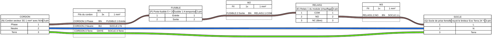

6. **Essai à la lampe** : brancher une lampe de chevet, interrupteur allumé, sur le socle, puis le cordon secteur et le bloc 12 V (**F**). La lampe reste éteinte tant que le relais 1 est relâché. Refaire le geste 1 de l'étape 7 (sachet de glaçons) : la lampe s'allume quand le relais s'enclenche, et s'éteint quand il se relâche.
7. Débrancher le cordon secteur, retirer la lampe.
8. **Câbles chauffants** (**W**) : brancher la multiprise (**V**) dans le socle, et les deux câbles chauffants dans la multiprise. Brancher enfin le cordon secteur.

### Variante : une rallonge à la place du socle

Sans socle de prise (**Q**), une rallonge courte, terminée d'un côté par une prise femelle et de l'autre par une fiche d'ordinateur (C14), en tient lieu : on coupe la fiche d'ordinateur, et la prise femelle reste au bout de son câble, hors du boîtier (**T**). Le cordon secteur (**N**) peut être un cordon d'ordinateur, dont on coupe la prise d'ordinateur (C13) en gardant la fiche murale. Le marron de la rallonge va directement sur la borne `NO` : le fil marron (**R**) ne sert pas. Ces images remplacent les gestes 1 à 3 ; les gestes 4 à 8 ne changent pas.

Sur le module relais KW-1613 (**E**), le relais 1 est marqué `K1`, tout à droite. Ses trois vis sont, de gauche à droite, `NO`, `COM` et `NC`, d'après le dessin imprimé dessous. Avant de câbler, module relais sans alimentation, au multimètre : `COM` sonne avec `NC`, et `COM` avec `NO` affiche `OL`. Sinon, ne rien brancher. Après la coupe, la broche de terre de la prise femelle sonne avec son fil vert-jaune.


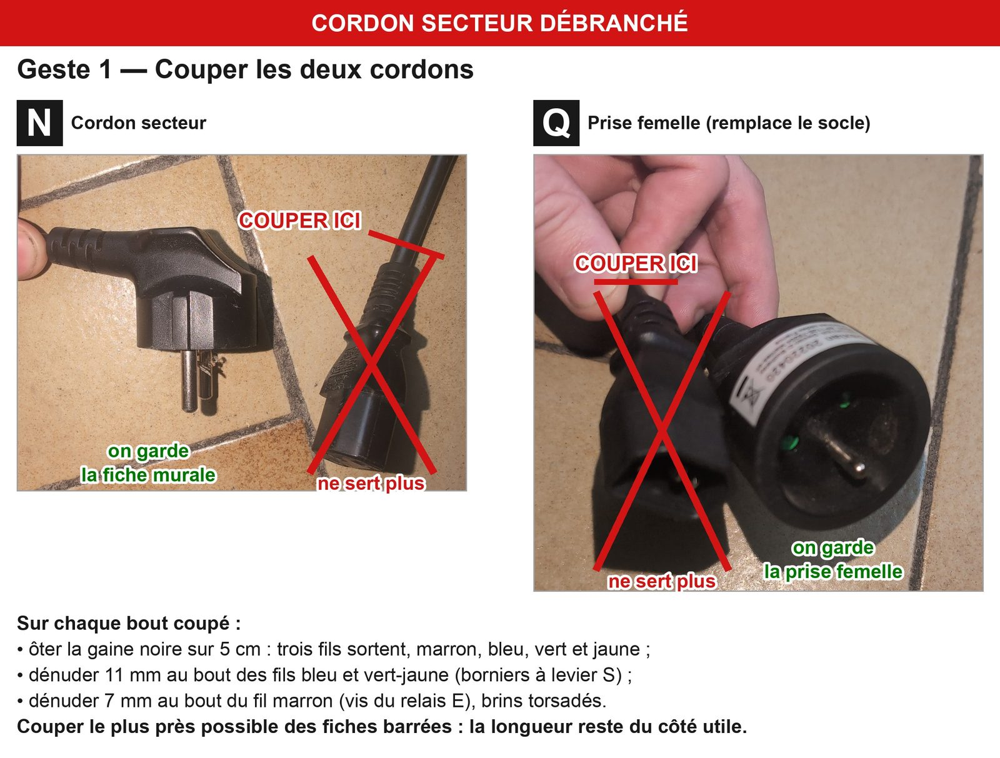

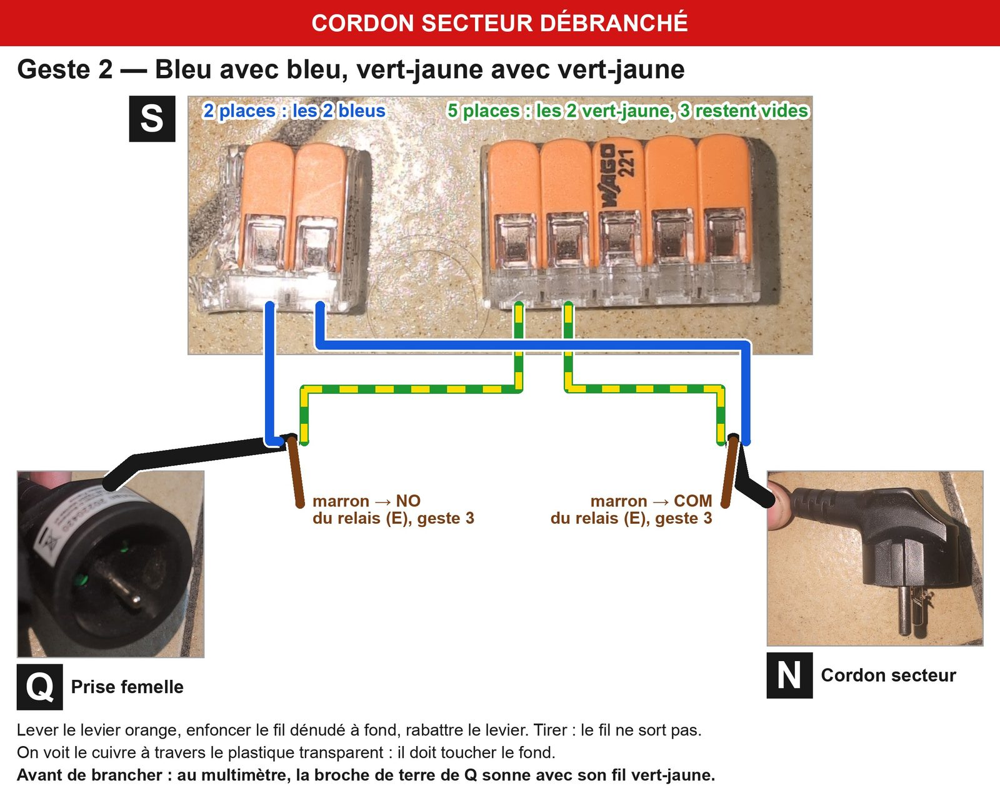

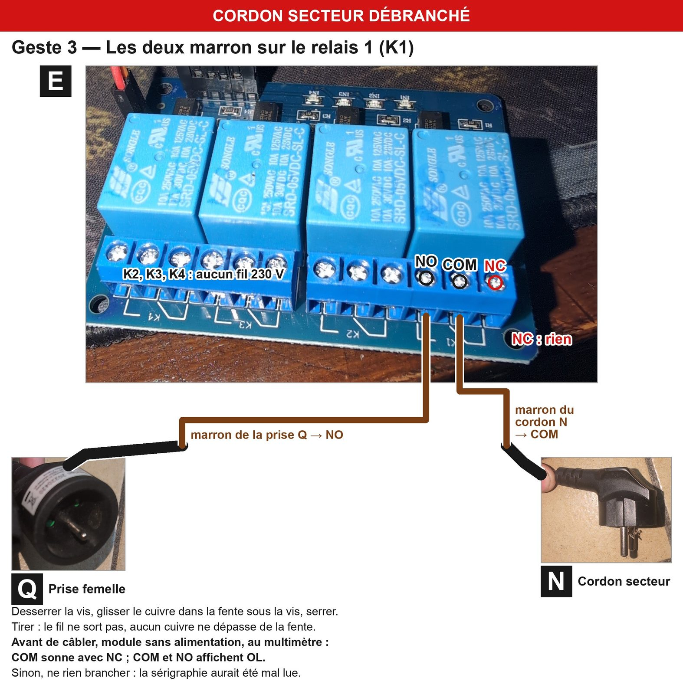

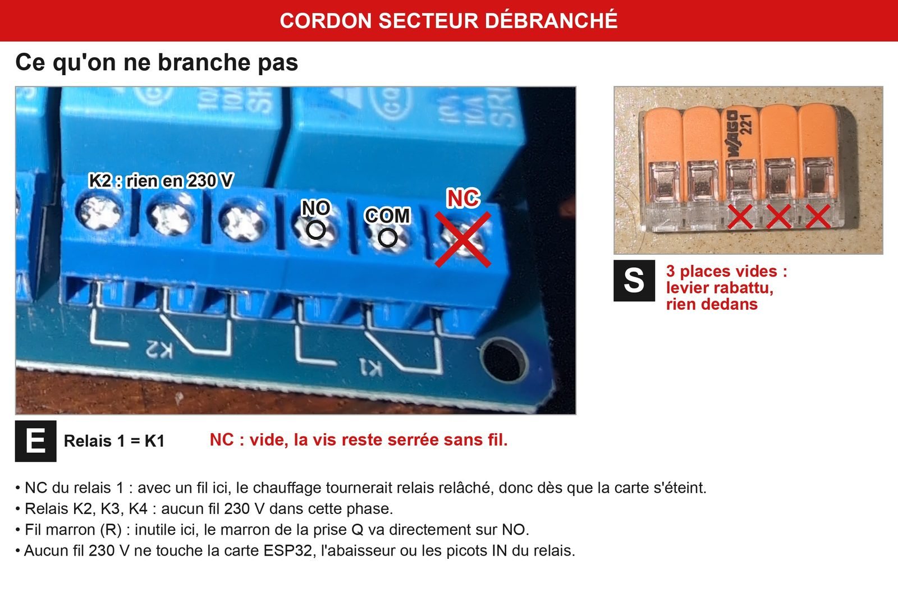

## Étape 10 — Mise en service

*Pièces : A, B, C, F, W.*

1. Capteur d'air (**B**) au centre du bac, à l'écart de l'emplacement de la future buse ; sonde du substrat (**C**) enfoncée dans le substrat.
2. Taper `MODE ACTIF` puis **Entrée**. Si l'air du bac est sous 18,5 °C, le relais 1 s'enclenche, et la ligne de mesure suivante affiche `chauffage=1`.
3. Suivre les mesures pendant quelques heures : la température monte vers 19 °C, puis le chauffage alterne autour de 19 °C. Une ligne `PAUSE chauffage apres 2 h continues` veut dire que les câbles ne suffisent pas à tenir la consigne : voir la section « Puissance de chauffe » du cadrage.
4. Une fois la consigne atteinte, mesurer la vitre côté intérieur, là où les escargots se posent, au thermomètre de contact ou infrarouge, et noter la valeur la plus chaude.
5. Débrancher le bloc 12 V (**F**) pendant que le chauffage tourne : le relais se relâche, les câbles chauffants (**W**) s'arrêtent. Rebrancher le bloc 12 V : la carte ESP32 (**A**) redémarre dans le mode enregistré.

## Fin de la phase 1

La phase est terminée quand les dix étapes donnent ce qu'elles annoncent. Reporter dans le cadrage du projet le résultat de l'étape 4 (module à déclenchement bas, ou non) et la température de vitre mesurée à l'étape 10.

L'hiver, laisser le régulateur en `ACTIF` pour l'élevage, ou en `HIBERNATION` pour la mise au repos : le mode survit aux coupures de courant. Une fois le Wi-Fi configuré ([supervision.md](../../supervision.md)), le mode `PLAGES` chauffe sur la consigne aux heures choisies et tient 12 °C le reste du temps ([mode-plages.md](../../mode-plages.md)).

## Crédits des illustrations

Illustrations de la liste du matériel, reprises sous licence libre et réduites :

- **A** — [ESP32.jpg](https://commons.wikimedia.org/wiki/File:ESP32.jpg), Edwiyanto, CC BY-SA 4.0.
- **B** — Adafruit SHT4x, vue « breadboard » de l'[Adafruit Fritzing Library](https://github.com/adafruit/Fritzing-Library), CC BY-SA 3.0.
- **C** — [Sensor DS18B20.jpg](https://commons.wikimedia.org/wiki/File:Sensor_DS18B20.jpg), Leonardo Postay, CC BY-SA 4.0.
- **D** — Adafruit Chainable DS18B20 Extender Breakout, [Adafruit Fritzing Library](https://github.com/adafruit/Fritzing-Library), CC BY-SA 3.0.
- **E** — [SRD-05VDC-SL-C 5V one-channel relay module.jpg](https://commons.wikimedia.org/wiki/File:SRD-05VDC-SL-C_5V_one-channel_relay_module.jpg), Suyash Dwivedi, CC BY-SA 4.0.
- **F** — [Philips 12 V Plug-in AC Adapter.JPG](https://commons.wikimedia.org/wiki/File:Philips_12_V_Plug-in_AC_Adapter.JPG), Jacek Rużyczka, CC BY-SA 4.0.
- **G** — [5.5x2.1mm-to-screwterminal adapters, male and female 01.jpg](https://commons.wikimedia.org/wiki/File:5.5x2.1mm-to-screwterminal_adapters,_male_and_female_01.jpg), Retired electrician, CC0.
- **H** — [LM2596 buck converter module, MP1584 buck converter module, and SDB628 boost converter module.jpg](https://commons.wikimedia.org/wiki/File:LM2596_buck_converter_module,_MP1584_buck_converter_module,_and_SDB628_boost_converter_module.jpg), Matthew Berardi, CC BY-SA 4.0.
- **J** — [2.1 mm DC Plug.jpg](https://commons.wikimedia.org/wiki/File:2.1_mm_DC_Plug.jpg), oomlout, CC BY-SA 2.0.
- **L** — [A few Jumper Wires.jpg](https://commons.wikimedia.org/wiki/File:A_few_Jumper_Wires.jpg), oomlout, CC BY-SA 2.0.
- **N** — [CEE-7-7-Stecker.jpg](https://commons.wikimedia.org/wiki/File:CEE-7-7-Stecker.jpg), SomnusDe, domaine public.
- **Q** — [French-power-socket.jpg](https://commons.wikimedia.org/wiki/File:French-power-socket.jpg), Etienne Rastoul, domaine public.
- **R** — [Installatiedraad.jpg](https://commons.wikimedia.org/wiki/File:Installatiedraad.jpg), Erik Wannee, CC0.
- **S** — [WAGO 221.jpg](https://commons.wikimedia.org/wiki/File:WAGO_221.jpg), im_tau, CC0.
- **T** — [IP65 junction box.JPG](https://commons.wikimedia.org/wiki/File:IP65_junction_box.JPG), Dmitry G, CC BY-SA 3.0.
- **V** — [Adaptateur électrique multiprise CEE 7 04.jpg](https://commons.wikimedia.org/wiki/File:Adaptateur_%C3%A9lectrique_multiprise_CEE_7_04.jpg), Coyau, CC BY-SA 3.0.

Images de la variante de l'étape 9 (`illustrations/etape-9/`) : photos et annotations de Sébastien Skorupski, sous la licence du dépôt.

Les pièces **M** et **W** n'ont pas d'illustration : aucune image sous licence libre ne les montrait fidèlement.
