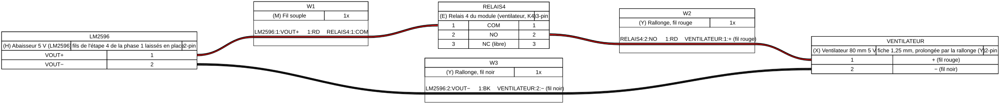
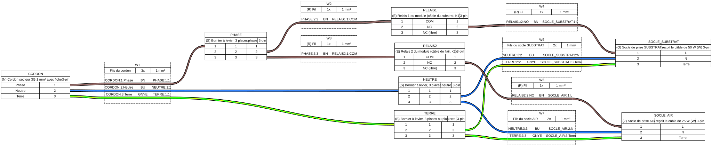

# Phase 2 — Le régulateur complet en local

La phase 2 apporte trois choses : la ventilation, le câble chauffant de l'air et la page web locale. **Cette notice couvre la ventilation et le câble de l'air** ; la page web s'y ajoutera, et le tag `phase-2` ne se posera qu'une fois les trois montées et validées. L'éclairage à l'heure, d'abord prévu ici, sort du régulateur : le ruban LED passe sur un programmateur horaire autonome, et son relais commande le câble de l'air (cadrage [ssk-terrarium-cadrage#2026-019](https://ssk-canon.s3-website.fr-par.scw.cloud/ssk-it/ssk-terrarium-cadrage/cadrages/2026-019)).

À la fin de cette notice, un ventilateur de 80 mm, fixé dans le couvercle, renouvelle l'air du bac : 5 minutes toutes les heures en `ACTIF` et en `PLAGES`, 5 minutes par jour en `HIBERNATION`, jamais en `MAINTENANCE`. La durée, la période et l'heure se règlent par la liaison série ou à distance ([ventilation.md](../../ventilation.md), cadrage [ssk-terrarium-cadrage#2026-013](https://ssk-canon.s3-website.fr-par.scw.cloud/ssk-it/ssk-terrarium-cadrage/cadrages/2026-013)).

La ventilation (étapes 1 à 6) et le câble de l'air (étapes 7 à 12) se montent l'un sans l'autre, dans cet ordre ou dans l'autre.

Durée de la ventilation : une heure, essais compris. Tout se passe en 5 V : aucune étape ne touche au 230 V de la phase 1, qui reste en place. On débranche quand même le cordon secteur (**N**) avant d'ouvrir le boîtier (**T**).

La notice part du montage de la [phase 1](../phase-1/README.md) terminé : capteurs, relais 1 au chauffage, carte ESP32 alimentée par le bloc 12 V.

## Ce qu'il faut

Les repères sont ceux de la phase 1 pour les pièces déjà montées ; les nouvelles pièces prennent les lettres suivantes, sans I ni O. Les pièces **X** et **Y** n'ont pas d'illustration : aucune image sous licence libre ne les montrait fidèlement. Le second socle (**Z**) est le même que le socle (**Q**) de la phase 1.

| Repère | Pièce | Ce que c'est, et sa référence d'achat |
| --- | --- | --- |
| **A** | Carte ESP32 | Montée à la phase 1 |
| **E** | Module relais | Monté à la phase 1 ; le relais 4 (`K4`), commandé par `IN4` depuis la broche 33, est encore libre |
| **F** | Bloc 12 V | Monté à la phase 1 |
| **H** | Abaisseur 5 V | Monté à la phase 1, réglé à 5,0 V ; il alimente déjà les bobines des relais, il alimentera aussi le ventilateur |
| **M** | Fil souple | Un fil rouge, assez long pour aller de l'abaisseur (**H**) aux vis du relais 4 |
| **N** | Cordon secteur | Monté à la phase 1 : on le débranche avant d'ouvrir le boîtier |
| **T** | Boîtier électrique | Celui de la phase 1 |
| **Q** | Socle de prise | Monté à la phase 1 ; il devient le socle **SUBSTRAT**, celui du câble du substrat |
| **R** | Fil marron 1 mm² | Trois longueurs, pour la phase des deux relais de chauffage (câble de l'air) |
| **S** | Borniers à levier | Pour le câble de l'air : un bornier à **3 places** pour la phase, un à **3 places** pour le neutre, à la place de celui à 2 places s'il y en avait un ; le bornier de la terre doit garder une place libre (celui à 5 places de la phase 1 en a trois) |
| **V** | Multiprise | Celle de la phase 1 : elle ne sert plus, chaque câble chauffant a sa prise |
| **W** | Câbles chauffants | Le câble de 6 m / 50 W, posé à la phase 1 au niveau du substrat, et le câble de 4,5 m / 25 W, Reptil'us HC Expert, à poser plus haut pour chauffer l'air |
| **X** | Ventilateur | Carré de 80 × 80 mm, 10,8 mm d'épaisseur, 5 V, 0,18 A, avec un câble de 10 cm terminé par une petite fiche à deux fils, rouge et noir, au pas de 1,25 mm. Une flèche moulée sur le cadre montre le sens de l'air. Kubii « Ventilateur 80x80x10.8mm » |
| **Y** | Rallonge du ventilateur | Câble à deux fils, rouge et noir, avec d'un côté une fiche qui s'accouple à celle du ventilateur (**X**), au pas de 1,25 mm (type Molex PicoBlade), et de l'autre des fils nus. Assez long pour aller du couvercle du bac au boîtier (**T**) |
| **Z** | Second socle de prise | Prise femelle à visser dans le boîtier, comme le socle (**Q**) : le socle **AIR**, celui du câble de l'air. Avec la variante de la phase 1, une seconde rallonge courte dont on coupe la fiche d'ordinateur |

Outils et accessoires, sans repère :

- le multimètre de la phase 1, en testeur de continuité et en voltmètre continu ;
- une grille fine, de la moustiquaire par exemple, pour que les escargots n'atteignent pas les pales, et de quoi fixer le ventilateur au couvercle (vis, colliers) ;
- le firmware : le fichier `.bin` de la version `phase-2`, sur sa page [Releases](https://github.com/sskorupski/ssk-terrarium/releases). Tant que le tag n'est pas posé, celui de `main`, compilé et téléversé par `pio run -e esp32dev -t upload` ([developpement.md](../../developpement.md)) ; ce téléversement-là garde les réglages enregistrés, mode et Wi-Fi compris, à l'inverse de l'image `.bin`.

## Étape 1 — Téléverser le firmware de la phase 2

*Pièces : A.*

Cordon secteur (**N**) et bloc 12 V (**F**) débranchés de la prise murale, carte ESP32 (**A**) reliée à l'ordinateur par l'USB :

1. Téléverser le firmware à l'adresse `0x0`, comme à l'étape 1 de la phase 1.
2. Ouvrir le terminal série, puis appuyer sur le bouton **RESET** de la carte ESP32.

Parmi ses lignes de démarrage, la carte ESP32 écrit :

```
MODE MAINTENANCE au demarrage
…
VENTILATION jour metronome duree=5min periode=60min ecart=30%
VENTILATION nuit metronome duree=5min periode=60min ecart=30%
VENTILATION hibernation heure=13:00 duree=5min
VENTILATION saturation inactive aeration humidite=95% attente=10min duree=5min pause=60min au demarrage
…
=== pret : regulation en cours ===
```

Les lignes `VENTILATION` donnent les réglages du ventilateur : de jour comme de nuit, 5 minutes d'aération toutes les 60 minutes ; l'aération quotidienne de l'hibernation à 13:00 ; l'option saturation inactive ([ventilation.md](../../ventilation.md)). Comme à la phase 1, le téléversement efface le mode enregistré : la carte repart en `MAINTENANCE`, où le ventilateur reste coupé. Les réglages de la phase 1 sont effacés de même, Wi-Fi compris : on les refera à l'étape 6.

Débrancher l'USB.

## Étape 2 — Vérifier la voie du ventilateur, à vide

*Pièces : A, E, F, H.*

**Ce qu'on vérifie, et pourquoi.** Le ventilateur sera branché sur le relais 4, qui n'a encore rien commandé. On vérifie, sans ventilateur, que la carte ESP32 l'enclenche et le relâche comme le firmware le prévoit, et l'on repère ses vis.

1. Cordon secteur (**N**) et bloc 12 V (**F**) débranchés, ouvrir le boîtier (**T**). **Repérer les vis du relais 4** comme celles du relais 1 à l'étape 4 de la phase 1 : sur le bord du module, les trois vis à côté du nom `K4`. Celle du milieu est **COM**. Multimètre en testeur de continuité, une pointe sur COM, l'autre sur chaque vis extérieure : celle qui sonne, relais relâché, est **NC** ; l'autre est **NO**. Marquer la vis **NO** au feutre.
2. Brancher la carte ESP32 par l'USB, puis le bloc 12 V sur la prise murale ; le cordon secteur reste débranché. Ouvrir le terminal série. Aucun relais ne s'enclenche.
3. Taper `CONFIG {"ventilation":{"jour":{"duree":1},"nuit":{"duree":1}}}` puis **Entrée** : la carte répond par les lignes `VENTILATION`, `jour` et `nuit` à `duree=1min`, la dernière finissant par `: enregistree`. Une minute d'aération suffit pour l'essai ; le jour et la nuit sont réglés ensemble, pour ne pas dépendre de l'heure qu'il est.
4. Taper `MODE ACTIF` puis **Entrée**. Un changement de mode commence par une aération : à la mesure suivante, dans les 30 secondes, **le relais 4 s'enclenche** et la carte écrit `VENTILATION marche`.
5. Environ une minute plus tard, le relais 4 se relâche, et la carte écrit `VENTILATION arret`.
6. Taper `MODE ACTIF` une seconde fois : la carte répond `MODE ACTIF deja actif`, et rien ne se passe. Taper `MODE HIBERNATION`, puis aussitôt `MODE ACTIF` : le changement de mode relance une aération, `VENTILATION marche`. Taper alors `MODE MAINTENANCE` : dans les 30 secondes, le relais 4 se relâche et la carte écrit `VENTILATION arret`.
7. Taper `CONFIG {"ventilation":{"jour":{"duree":5},"nuit":{"duree":5}}}` pour revenir aux 5 minutes, puis débrancher le bloc 12 V et l'USB.

**Le résultat attendu** : le relais 4 ne s'enclenche qu'avec `VENTILATION marche`, et se relâche avec `VENTILATION arret`. Un relais 4 qui s'enclenche à un autre moment, ou un autre relais qui s'enclenche avec lui : s'arrêter là, et vérifier le fil de `IN4` (étape 5 de la phase 1).

## Étape 3 — Préparer le ventilateur

*Pièces : X, Y.*

1. Enfoncer la fiche du ventilateur (**X**) dans celle de la rallonge (**Y**), jusqu'au clic.
2. Repérer, au bout nu de la rallonge, le fil qui prolonge le **rouge** du ventilateur : multimètre en testeur de continuité, une pointe sur la petite languette métallique du fil rouge, au dos de la fiche du ventilateur, l'autre sur chaque fil nu tour à tour. Celui qui sonne est le **+**. Le marquer au feutre s'il n'est pas rouge. L'autre est le **−**. Un ventilateur branché à l'envers ne tourne pas, et peut griller.
3. Fixer le ventilateur au couvercle du bac, devant une ouverture de sa taille, **la flèche du sens de l'air tournée vers l'extérieur** : il aspire l'air humide du bac et le rejette dehors. Poser la grille fine côté bac, entre les escargots et les pales.
4. Faire passer la rallonge du couvercle au boîtier (**T**), par le même chemin que les câbles des capteurs. Seule de la très basse tension entre dans le bac ou touche son couvercle (INV-4).

## Étape 4 — Brancher le ventilateur

*Pièces : E, H, M, Y.*

Cordon secteur (**N**) et bloc 12 V (**F**) débranchés de la prise murale, câble USB débranché. Les fils de l'abaisseur (**H**) posés à l'étape 4 de la phase 1 restent en place : le Dupont rouge de **VOUT+** vers `JD-VCC`, le noir de **VOUT−** vers `GND`. Les nouveaux fils se serrent sous les mêmes vis, à côté d'eux :

1. Un fil souple rouge (**M**) de la vis **VOUT+** de l'abaisseur à la vis **COM** du relais 4 (celle du milieu).
2. Le fil **+** de la rallonge (**Y**) sur la vis **NO** du relais 4, celle marquée à l'étape 2.
3. Le fil **−** de la rallonge sur la vis **VOUT−** de l'abaisseur.
4. La vis **NC** du relais 4 reste libre.
5. Tirer doucement sur chaque fil, nouveaux comme anciens : aucun ne doit sortir de sous sa vis.
6. **Vérifier avant d'alimenter**, multimètre en testeur de continuité : entre **VOUT+** et la vis **NO** du relais 4, rien ne sonne. Le ventilateur ne reçoit donc rien tant que le relais est relâché, même si la carte ESP32 s'arrête (RG-relais-coupes-sans-commande).



Le ventilateur tire 0,18 A sous 5 V. L'abaisseur, qui débite environ 0,3 A pour les bobines des quatre relais, les fournit sans peine.

## Étape 5 — Essayer le ventilateur

*Pièces : A, F, H, X.*

1. Brancher la carte ESP32 (**A**) par l'USB, puis le bloc 12 V (**F**) ; le cordon secteur reste débranché. Ouvrir le terminal série. La carte est en `MAINTENANCE` depuis l'étape 2 : le ventilateur (**X**) ne tourne pas.
2. Taper `MODE ACTIF` puis **Entrée**. Dans les 30 secondes, `VENTILATION marche` : le relais 4 s'enclenche et **le ventilateur tourne**. Une main posée au-dessus du couvercle sent l'air sortir.
3. Pendant qu'il tourne, l'afficheur de l'abaisseur (**H**), basculé sur sa tension de sortie, indique toujours 5,0 V environ. Noter la valeur.
4. Cinq minutes plus tard, `VENTILATION arret` : le ventilateur s'arrête. Le suivant tournera une heure après le premier.
5. Taper `MODE MAINTENANCE` pendant une aération : le ventilateur s'arrête dans les 30 secondes.
6. **Hibernation** : taper `MODE HIBERNATION`. Le ventilateur ne tourne pas à l'entrée dans le mode : il tournera une fois par jour, à 13:00 si la carte connaît l'heure, sinon 24 heures après l'entrée dans le mode. Pour le voir sans attendre, une fois le Wi-Fi configuré et l'heure connue (`PLAGES` l'affiche), taper l'heure qu'il est dans `CONFIG {"ventilation":{"hibernation":{"heure":"15:42"}}}` : le ventilateur tourne à la mesure suivante. Remettre ensuite `CONFIG {"ventilation":{"hibernation":{"heure":"13:00"}}}`.

## Étape 6 — Remettre en service

*Pièces : A, F, N, T.*

1. Débrancher le bloc 12 V et l'USB, refermer le boîtier (**T**), puis rebrancher le cordon secteur (**N**) et le bloc 12 V.
2. Taper le mode voulu, `MODE ACTIF` pour l'élevage ou `MODE HIBERNATION` pour la mise au repos. Si le Wi-Fi servait, le reconfigurer ([supervision.md](../../supervision.md)) ; refaire de même les plages et le fuseau du mode `PLAGES` s'ils avaient été changés ([mode-plages.md](../../mode-plages.md)).
3. Taper `VENTILATION` : la carte répond par ses quatre lignes de réglages, la dernière finissant par `actuelle`.

## Fin de la ventilation

La ventilation est montée quand les six étapes donnent ce qu'elles annoncent. Reporter dans le cadrage [ssk-terrarium-cadrage#2026-013](https://ssk-canon.s3-website.fr-par.scw.cloud/ssk-it/ssk-terrarium-cadrage/cadrages/2026-013) la tension de l'abaisseur mesurée à l'étape 5 avec le ventilateur en marche.

Les valeurs de 5 minutes par heure restent à éprouver : les lignes `MESURE` montrent l'humidité du bac avant et après chaque aération. Une humidité qui chute trop appelle une aération plus courte ou plus rare ; un air qui reste saturé, l'inverse. Les réglages se changent sans rien rebrancher, par `CONFIG` sur la liaison série ou à distance : durée et période de jour et de nuit, mode `rubato` pour une ventilation moins régulière, jour et nuit au fil des saisons, option saturation ([ventilation.md](../../ventilation.md)), dans les bornes du firmware.

## Le câble chauffant de l'air

Le câble de la phase 1, au niveau du substrat, chauffe surtout le terreau. Quand le substrat atteint son seuil, la coupure par le substrat l'arrête, et l'air du bac n'est plus chauffé jusqu'à ce que le substrat soit redescendu : des heures, une nuit d'hiver. Le câble de l'air, posé plus haut, prend le relais 2, laissé libre par l'éclairage :

- les deux câbles chauffent ensemble quand l'air est sous la consigne, dans tous les modes ;
- la coupure par le substrat n'arrête que le câble du substrat : le câble de l'air continue jusqu'à ce que l'air atteigne la consigne ;
- le câble de l'air s'arrête quand le substrat atteint **28 °C**, et reprend sous **26 °C**, tant que la coupure par le substrat est active. Ce plafond n'est pas un réglage.

Le pourquoi est dans le cadrage [ssk-terrarium-cadrage#2026-019](https://ssk-canon.s3-website.fr-par.scw.cloud/ssk-it/ssk-terrarium-cadrage/cadrages/2026-019). La puissance totale reste de 75 W. Il n'y a toujours ni fusible ni limiteur matériel ([#9](https://github.com/sskorupski/ssk-terrarium/issues/9), [#10](https://github.com/sskorupski/ssk-terrarium/issues/10)) : si un relais reste collé, rien de matériel ne coupe son câble.

Durée : deux heures, pose du câble comprise. Les étapes 7 et 8 ne touchent qu'au 5 V et au 3,3 V ; l'étape 9 câble le 230 V, avec les mêmes précautions qu'à l'étape 9 de la phase 1 : **tout se fait cordon secteur débranché**, et qui n'a jamais câblé de 230 V la fait faire par quelqu'un qui en a l'habitude.

## Étape 7 — Mettre à jour le firmware

*Pièces : A.*

Le firmware qui commande le câble de l'air remplace celui de la ventilation. Une fois le Wi-Fi configuré, il s'installe à distance, sans ouvrir le boîtier ([supervision.md](../../supervision.md#mettre-à-jour-le-firmware-à-distance)) ; sinon, par l'USB, comme à l'étape 1.

Au démarrage, la ligne `MESURE` porte un champ de plus, `chauffage_air`, à côté de `chauffage` :

```
MESURE air=17.8C hr=62% (sht45) sht45=17.8C/62% dht11=18.0C/58% substrat=17.5C chauffage=0 chauffage_air=0 mode=MAINTENANCE heure=--
```

`chauffage` est le câble du substrat, sur le relais 1 ; `chauffage_air` le câble de l'air, sur le relais 2.

## Étape 8 — Vérifier la voie du câble de l'air, à vide

*Pièces : A, B, C, E, F.*

**Ce qu'on vérifie, et pourquoi.** Le relais 2 n'a encore rien commandé. On vérifie, sans 230 V, qu'il s'enclenche avec le relais 1, qu'il ne s'arrête pas avec lui quand le substrat est trop chaud, et qu'il s'arrête à 28 °C. Il faut de la glace pour refroidir le capteur d'air, et deux verres d'eau, l'un tiède, l'autre chaude, pour chauffer la sonde du substrat, qui est étanche.

1. Cordon secteur (**N**) et bloc 12 V (**F**) débranchés, ouvrir le boîtier (**T**). **Repérer les vis du relais 2** comme celles du relais 1 à l'étape 4 de la phase 1 : sur le bord du module, les trois vis à côté du nom `K2`. Celle du milieu est **COM**. Multimètre en testeur de continuité, relais relâché, une pointe sur COM, l'autre sur chaque vis extérieure : celle qui sonne est **NC** ; l'autre est **NO**. Marquer la vis **NO** au feutre.
2. Brancher la carte ESP32 (**A**) par l'USB, puis le bloc 12 V ; le cordon secteur reste débranché. Ouvrir le terminal série, et taper `SUBSTRAT` : **noter la ligne** qu'elle écrit, pour remettre les réglages au geste 9.
3. Pour l'essai, abaisser la coupure à 20 °C et sa reprise à 18 °C, sans approche. Taper `CONFIG {"securite_substrat":{"active":true,"approche":0,"jour":{"coupure":20,"reprise":18},"nuit":{"coupure":20,"reprise":18}}}` puis **Entrée** : la carte répond par la ligne `SUBSTRAT`, finie par `: enregistree`.
4. Taper `MODE ACTIF`, puis poser le sachet de glaçons sur le capteur d'air (**B**), comme à l'étape 7 de la phase 1. Quand l'air passe sous la consigne, **les relais 1 et 2 s'enclenchent ensemble**, et la ligne `MESURE` affiche `chauffage=1 chauffage_air=1`.
5. Glaçons toujours en place, plonger la sonde du substrat (**C**) dans l'eau **tiède**, entre 22 et 26 °C : la ligne `MESURE` le dit, `substrat=`. Ajouter de l'eau froide ou chaude pour y rester. Dès 20 °C, la carte écrit `COUPURE chauffage : substrat a …` : **le relais 1 se relâche, le relais 2 reste enclenché**, et la ligne `MESURE` affiche `chauffage=0 chauffage_air=1`.
6. Plonger la sonde dans l'eau **chaude**, au-dessus de 30 °C, sans dépasser 60 °C : dès 28 °C, **le relais 2 se relâche à son tour**, et `MESURE` affiche `chauffage=0 chauffage_air=0`.
7. Sortir la sonde de l'eau et la laisser refroidir à l'air : sous 26 °C, le relais 2 s'enclenche de nouveau ; sous 18 °C, le relais 1 aussi.
8. Retirer les glaçons : quand l'air dépasse la consigne plus l'hystérésis, les deux relais se relâchent ensemble.
9. Remettre les réglages notés au geste 2, par `CONFIG {"securite_substrat":{…}}` avec les valeurs de la ligne `SUBSTRAT` : par défaut, `{"securite_substrat":{"approche":0,"jour":{"coupure":24,"reprise":18.5},"nuit":{"coupure":24,"reprise":18.5}}}`. Taper `SUBSTRAT` : la ligne est celle du geste 2. Taper `MODE MAINTENANCE`, puis débrancher le bloc 12 V et l'USB.

**Le résultat attendu** : les deux relais s'enclenchent ensemble sur l'air ; la coupure par le substrat ne relâche que le relais 1 ; le relais 2 ne se relâche qu'à 28 °C. Un relais 2 qui se relâche avec le relais 1 au geste 5, ou qui ne s'enclenche pas au geste 4 : s'arrêter là, et vérifier le fil de `IN2` (étape 5 de la phase 1) et la version du firmware.

## Étape 9 — Câbler le 230 V du câble de l'air

*Pièces : E, N, Q, R, S, T, Z.*

**Toute cette étape se fait cordon secteur débranché.** Le boîtier (**T**) ne se rebranche qu'à l'étape 10, refermé.

La **phase** du cordon secteur, qui allait jusqu'ici au seul relais 1, se partage maintenant entre le relais 1 et le relais 2, par un bornier. Chaque relais coupe la phase de son socle : le relais 1 celui du câble du substrat, le relais 2 celui du câble de l'air. Le neutre et la terre vont directement aux deux socles.

1. Dans le boîtier, fixer le second socle de prise (**Z**) à côté du premier (**Q**). Marquer au feutre ou à l'étiquette le premier **SUBSTRAT**, le second **AIR**.
2. **La phase.** Retirer le fil marron du cordon secteur (**N**) de la vis **COM** du relais 1, et le pincer dans un bornier à levier à 3 places (**S**). Du même bornier, un fil marron (**R**) vers la vis **COM** du relais 1, et un autre vers la vis **COM** du relais 2.
3. Vis **NO** du relais 2 vers la borne **L** du socle AIR, par un fil marron (**R**). Rien ne se branche sur la vis **NC** du relais 2. La vis **NO** du relais 1 reste reliée au socle SUBSTRAT, comme à la phase 1.
4. **Le neutre.** Le bleu du cordon, celui du socle SUBSTRAT et celui du socle AIR dans un même bornier à 3 places, à la place de celui à 2 places s'il y en avait un.
5. **La terre.** Le vert et jaune du socle AIR dans une place libre du bornier de la terre, avec ceux du cordon et du socle SUBSTRAT.
6. Serrer chaque vis des relais et des socles, abaisser chaque levier, puis tirer sur chaque fil : aucun ne doit sortir. Aucun fil 230 V ne touche la carte ESP32, l'abaisseur ou les picots `IN` du module.
7. **Vérifier avant d'alimenter**, module relais sans alimentation, multimètre en testeur de continuité : la broche **L** du socle AIR ne sonne avec rien, ni avec la phase du cordon ni avec la borne L du socle SUBSTRAT ; la broche **N** de chaque socle sonne avec le neutre de la fiche du cordon, et sa broche de **terre** avec celle de la fiche.
8. Refermer le boîtier.



**Avec la variante de la phase 1** (une rallonge à la place du socle), le socle AIR est une seconde rallonge courte dont on coupe la fiche d'ordinateur. Son marron va directement sur la vis **NO** du relais 2 : le fil du geste 3 ne sert pas. Ses bleu et vert et jaune rejoignent les borniers du neutre et de la terre, comme aux gestes 4 et 5.

## Étape 10 — Essayer à la lampe, et reconnaître les prises

*Pièces : A, B, C, F, N.*

Une lampe de chevet, interrupteur allumé, montre ce que fait chaque prise ; c'est aussi l'occasion de vérifier qu'on n'a pas inversé les deux.

1. Brancher la lampe sur le socle **AIR**, puis le cordon secteur (**N**) et le bloc 12 V (**F**). La lampe reste éteinte.
2. Abaisser la coupure à 20 °C comme au geste 3 de l'étape 8, taper `MODE ACTIF` et poser les glaçons sur le capteur d'air : la lampe s'allume avec les relais.
3. Sonde du substrat dans l'eau tiède, entre 22 et 26 °C : `COUPURE chauffage` s'écrit, et **la lampe reste allumée**.
4. Débrancher le cordon secteur, passer la lampe sur le socle **SUBSTRAT**, rebrancher le cordon. Sonde toujours dans l'eau tiède : **la lampe est éteinte**. Sortir la sonde et la laisser refroidir sous 18 °C : la lampe s'allume.
5. Retirer les glaçons, remettre les réglages du substrat comme au geste 9 de l'étape 8, taper `MODE MAINTENANCE`. Débrancher le cordon secteur et retirer la lampe.

**Si la lampe s'éteint au geste 3**, les prises sont inversées, ou le câblage de l'étape 9 l'est : ne pas brancher les câbles chauffants avant d'avoir trouvé pourquoi. Le câble de l'air serait coupé avec le substrat, et le câble du substrat chaufferait au-delà de son seuil.

## Étape 11 — Poser le câble de l'air

*Pièces : W.*

Le câble de 4,5 m / 25 W (**W**) se pose comme celui de la phase 1 :

1. **À l'extérieur du bac, contre une vitre, jamais dans le bac ni dans son couvercle** : seule la très basse tension y entre (INV-4). Une vitre latérale ou arrière, **plus haut que le substrat**, au-dessus du câble de la phase 1.
2. En allers-retours, à environ 4 cm d'écart : le câble ne se croise jamais lui-même et ne se superpose pas, sous peine de chauffer en un point jusqu'à s'abîmer.
3. Recouvrir de l'isolant, comme le premier.
4. Brancher la fiche du câble de l'air sur le socle **AIR**, celle du câble du substrat sur le socle **SUBSTRAT**. La multiprise (**V**) ne sert plus.

## Étape 12 — Remettre en service

*Pièces : A, F, N.*

1. Rebrancher le cordon secteur (**N**) et le bloc 12 V (**F**), et taper le mode voulu, `MODE ACTIF` ou `MODE PLAGES`.
2. Taper `SUBSTRAT` : la ligne est celle du geste 2 de l'étape 8.
3. Suivre les lignes `MESURE` pendant une nuit, ou l'historique s'il est en place : pendant une coupure par le substrat, `chauffage=0` et `chauffage_air=1`, et l'air ne chute plus comme avant.

## Fin du câble de l'air

Le câble de l'air est monté quand les étapes 7 à 12 donnent ce qu'elles annoncent. Reporter dans le cadrage [ssk-terrarium-cadrage#2026-019](https://ssk-canon.s3-website.fr-par.scw.cloud/ssk-it/ssk-terrarium-cadrage/cadrages/2026-019) où le câble a été posé, et ce que montre la première nuit : la température de l'air pendant les coupures, et si elle tient la consigne.
